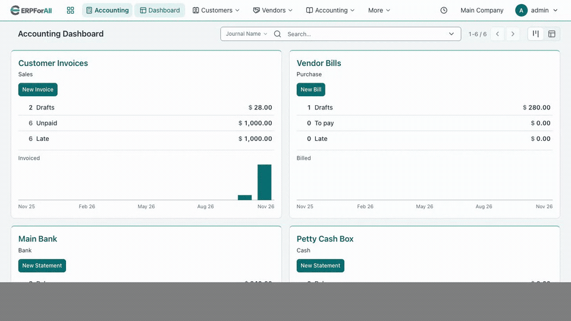

# ERPForAll End-to-End Full-Cycle Showcase

Live screenshots and HD walkthrough video captured from a self-hosted ERPForAll instance populated with demo data, covering the complete **Procure-to-Pay → Warehouse → Order-to-Cash → Financial Reporting → HR** cycle.

## Full-Cycle Walkthrough Video

   
  <a href="full-cycle-demo.mp4"><b>▶ Watch / Download Full HD Walkthrough Video (MP4 · 1280×720 · 1.5 MB)</b></a>

## Screenshot Gallery (1440×900 HiDPI)

| # | Module | Screen | Preview |
|---|---|---|---|
| 01 | **Accounting** | Accounting Dashboard | [01-accounting-dashboard.png](screenshots/01-accounting-dashboard.png) |
| 02 | **Purchase** | Confirmed Purchase Order (`PO00001`) with 3-Way Match & Chatter | [02-purchase-order.png](screenshots/02-purchase-order.png) |
| 03 | **Inventory** | Warehouse Overview Operation Cards | [03-inventory-overview.png](screenshots/03-inventory-overview.png) |
| 04 | **Inventory** | Validated Delivery Transfer (`Main/OUT/00002`) | [04-stock-transfer.png](screenshots/04-stock-transfer.png) |
| 05 | **Sales** | Sales Quotation (`SO-DEMO-002`) with Optional Products & Margins | [05-sales-order.png](screenshots/05-sales-order.png) |
| 06 | **Accounting** | Posted Customer Invoice (`INV/2026/00005`) | [06-customer-invoice.png](screenshots/06-customer-invoice.png) |
| 07 | **Dynamic Reports** | Partner Ledger (Unfolded, Running Balance & Overdue Highlighting) | [07-partner-ledger.png](screenshots/07-partner-ledger.png) |
| 08 | **Dynamic Reports** | General Ledger (Account Code + Name, Chronological Items) | [08-general-ledger.png](screenshots/08-general-ledger.png) |
| 09 | **Dynamic Reports** | Trial Balance (Multi-Period Side-by-Side Comparison) | [09-trial-balance.png](screenshots/09-trial-balance.png) |
| 10 | **Dynamic Reports** | Balance Sheet (Classified Assets = Liabilities + Equity) | [10-balance-sheet.png](screenshots/10-balance-sheet.png) |
| 11 | **Dynamic Reports** | Profit and Loss (Gross Profit, Expenses & Net Profit) | [11-profit-and-loss.png](screenshots/11-profit-and-loss.png) |
| 12 | **Dynamic Reports** | Purchase Report (Vendor → PO with Overdue Arrival Tone) | [12-purchase-report.png](screenshots/12-purchase-report.png) |
| 13 | **Employees (HR)** | Employee Directory, Department Tree & Tags | [13-employees-directory.png](screenshots/13-employees-directory.png) |
